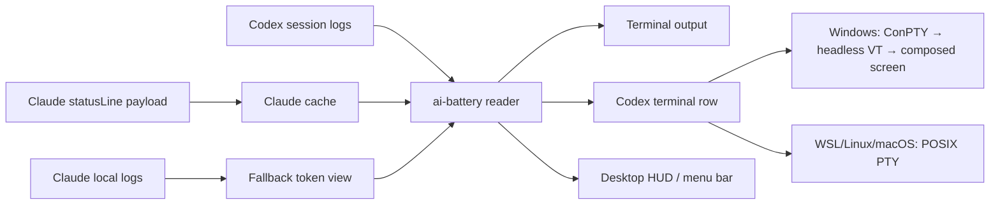

# AI Battery

[한국어](README.md) · [English](docs/i18n/en/) · [日本語](docs/i18n/ja/) · [中文](docs/i18n/zh/) · [Español](docs/i18n/es/)

Codex and Claude Usage Battery Meter

Codex와 Claude Code의 남은 사용량을 배터리처럼 확인하는 터미널 상태 표시 도구입니다.


[Install](#install) · [Features](#features) · [Quick Start](#quick-start) · [Claude StatusLine](#claude-statusline) · [Desktop HUD](#desktop-hud) · [Caution](#caution)

## Overview

`ai-battery`는 Codex와 Claude Code를 사용하면서 남은 사용량과 리셋 시간을 계속 확인하기 위한 작은 상태 표시 도구입니다.

Codex는 로컬 세션 로그의 `rate_limits` 이벤트를 읽고, Claude Code는 `statusLine` hook이 전달하는 rate-limit payload를 캐시해서 사용합니다. Claude가 실제 429 rate-limit hit를 기록한 경우에는 해당 reset 전까지 그 제한을 0%로 반영합니다. 기본 출력은 한 줄로 작게 유지되며, 실행 중인 도구는 흰색, 실행 중이지 않은 도구는 회색으로 표시합니다. 배터리 바 색상만 잔량에 따라 초록, 주황, 빨강으로 바뀝니다.


Markdown의 텍스트 fallback은 렌더러별 블록 문자 높이 차이를 피하려고 바를 생략합니다. 실제 터미널에서는 ANSI 색상과 블록 바가 함께 렌더링됩니다.

```text
Codex 86% │ 5h 18:09 │ 7d 82%  ┃  Claude 4% │ 5h 18:10 │ 7d 71%
```

| Provider | Source | Shows |
| --- | --- | --- |
| Codex | `~/.codex/sessions/**/*.jsonl` | 5h 잔량, 5h 리셋 시각, 7d 잔량 |
| Claude Code | Claude `statusLine` payload cache + 429 hit logs | 5h 잔량, 5h 리셋 시각, 7d 잔량 |
| Claude fallback | `~/.claude/projects/**/*.jsonl` | 최근 턴 토큰 사용량 |

## Features

| Feature | Description |
| --- | --- |
| 공통 사용량 표시 | Codex와 Claude Code 사용량을 같은 형식으로 표시합니다. |
| 리셋 시각 표시 | `5h`, `7d` 창 라벨과 값을 표시합니다. |
| 색상 기준 | 40% 초과 초록, 21-40% 주황, 20% 이하 빨강으로 배터리만 강조합니다. |
| Codex terminal row | Codex 아래에 별도 사용량 행을 고정하는 PTY wrapper를 제공합니다. |
| Claude statusLine | Claude Code 내장 statusLine hook과 실제 429 hit 로그로 Claude rate limit 상태를 읽습니다. |
| HUD / menu bar | Windows native/WSL에서는 floating HUD, macOS에서는 menu bar status item을 제공합니다. |
| npm 실행 | `npm install -g` 또는 `npx`로 실행할 수 있습니다. |

## Platform Support

| Mode | Windows native | WSL | Linux | macOS | Note |
| --- | --- | --- | --- | --- | --- |
| `ai-battery` | 지원 | 지원 | 지원 | 지원 | Node.js 18 이상이 필요합니다. |
| `ai-battery --watch` | 지원 | 지원 | 지원 | 지원 | 터미널 안에서 주기적으로 갱신합니다. |
| Claude statusLine | 지원 | 지원 | 지원 | 지원 | Claude Code `statusLine`에 `node <script>` 명령을 저장합니다. |
| Codex terminal row | 지원 | 지원 | 지원 | 지원 | Windows는 기본 VT compositor가 자식 ConPTY를 격리된 `rows - 1` 화면에 렌더링한 뒤 상태 행과 합성합니다. compositor를 사용할 수 없으면 상태 행 없이 안전하게 일반 Codex를 실행합니다. WSL/Linux/macOS는 POSIX PTY와 `python3`를 사용합니다. |
| `ai-battery setup codex` | 지원 | 지원 | 지원 | 지원 | Codex `[tui].status_line`을 맞추고, Windows는 `codex.cmd` wrapper, WSL/Linux/macOS는 POSIX shell wrapper를 설치합니다. |
| `ai-battery hud` | 지원 | 지원 | 미지원 | 지원 | Windows/WSL은 PowerShell/WinForms HUD, macOS는 menu bar status item입니다. |

실행 중 감지는 Linux/WSL은 `/proc`, macOS는 `ps`, Windows는 PowerShell 프로세스 목록을 사용합니다. 텍스트 출력은 흰색/회색으로, macOS HUD는 실행 중인 항목만 색상 배터리바로 강조하고 비실행 항목은 흐린 회색 계열로 표시합니다.

## Install

```bash
npm install -g ai-battery
```

설치하지 않고 바로 실행할 수도 있습니다.

```bash
npx ai-battery
```

이전 이름인 `claudex-battery`, `claudex-battery-run`, `claudex-battery-hud` 명령도 호환 alias로 함께 제공됩니다.

## Quick Start

1. 패키지를 설치합니다.

   ```bash
   npm install -g ai-battery
   ```

2. Claude와 Codex 자동 표시를 설정합니다.

   ```bash
   ai-battery setup
   ```

3. 이후에는 원래 명령을 그대로 사용합니다.

   ```bash
   claude
   codex
   ```

4. 데스크톱 HUD나 macOS menu bar 표시가 필요하면 실행합니다.

   ```bash
   ai-battery hud
   ```

## CLI

```bash
ai-battery
ai-battery --watch 10
ai-battery --json
ai-battery --version
ai-battery --provider codex
ai-battery --provider claude
ai-battery setup
ai-battery uninstall
ai-battery doctor
ai-battery hud
ai-battery off codex
ai-battery on codex
```

| Option | Description |
| --- | --- |
| `--provider all\|codex\|claude` | 표시할 provider를 선택합니다. |
| `--watch [seconds]` | 같은 줄에서 주기적으로 갱신합니다. |
| `--json` | HUD나 다른 도구에서 쓰기 좋은 JSON을 출력합니다. |
| `--bar-width N` | 터미널 배터리 바 길이를 조정합니다. |
| `--show-paths` | 로그 파일 경로와 데이터 관측 시각을 함께 표시합니다. |
| `-v`, `--version` | 설치된 `ai-battery` 버전을 출력합니다. |

`doctor`는 설치 상태와 함께 npm latest 버전을 확인합니다. 네트워크가 막혀 있으면 버전 확인만 건너뛰고 나머지 진단은 계속 표시합니다.

## Uninstall

`off`는 표시만 숨기는 설정이고, `uninstall`은 `setup`과 HUD autostart가 만든 통합 지점을 제거합니다.

```bash
ai-battery uninstall
```

일부만 제거할 수도 있습니다.

```bash
ai-battery uninstall codex
ai-battery uninstall claude
ai-battery uninstall hud
```

이 명령은 AI Battery가 관리 마커를 넣은 Codex wrapper, Codex `[tui].status_line`, Claude `statusLine`, HUD/menu bar autostart와 실행 중인 HUD를 정리합니다. 다른 도구가 만든 `codex` 파일이나 Claude `statusLine`은 건드리지 않습니다. Codex config가 setup 이후 사용자가 수정한 상태라면 안전하게 그대로 둡니다. 이전 버전이나 `--force`로 기존 파일을 백업한 경우에는 가능한 한 원래 파일/symlink를 복원합니다. 현재 이미 AI Battery wrapper 안에서 실행 중인 Codex 세션의 terminal row는 그 세션을 종료해야 사라집니다.

최신 npm은 패키지의 uninstall lifecycle을 실행하지 않기 때문에 `npm uninstall ai-battery` 또는 `npm uninstall -g ai-battery`만으로는 외부 통합 지점을 자동 정리할 수 없습니다. 완전히 제거하려면 npm 패키지를 지우기 전에 먼저 실행하세요.

```bash
ai-battery uninstall
npm uninstall -g ai-battery
```

이미 npm 패키지를 먼저 지운 뒤라면, 다시 설치한 다음 `ai-battery uninstall`을 실행하거나 아래 항목을 직접 확인해 제거해야 합니다: AI Battery가 만든 Codex wrapper, shell rc의 `# >>> ai-battery setup >>>` block, Codex `~/.codex/config.toml`의 `[tui].status_line`, Claude `statusLine`, HUD/menu bar autostart.

## Setup

`setup`은 한 번만 실행합니다. Claude Code에는 statusLine hook을 설치하고, Codex에는 기본 status line 구성과 platform wrapper를 설치해서 이후에는 추가 명령 없이 원래처럼 실행하게 합니다.

```bash
ai-battery setup
```

일부만 설정할 수도 있습니다.

```bash
ai-battery setup claude
ai-battery setup codex
```

Codex setup은 `~/.codex/config.toml`의 `[tui]`에 `model-with-reasoning`, `current-dir`, `git-branch` status line을 설정합니다. 기존 값이 있으면 uninstall 복구용으로 백업합니다. Codex wrapper는 기존 `codex` 명령을 직접 덮어쓰지 않습니다. `~/.local/bin`이 이미 PATH에서 원본 `codex`보다 앞에 있고 `~/.local/bin/codex`가 비어 있거나 AI Battery 관리 파일이면 그 위치에 wrapper를 둬서 바로 잡히게 합니다. 그렇지 않으면 `~/.local/share/ai-battery/bin/codex`에 관리형 wrapper를 만들고, 필요한 경우 셸 설정에 이 디렉터리를 PATH 앞쪽으로 추가합니다. `~/.local/bin/codex` 같은 공용 위치에 이미 다른 파일이 있으면 덮어쓰지 않습니다. 새 터미널부터 `codex`가 자동으로 AI Battery 하단 행과 함께 실행됩니다. 같은 터미널에서 이미 `codex`를 실행한 적이 있으면 셸 캐시 때문에 `hash -r`이 한 번 필요할 수 있고, PATH 추가가 필요한 경우에는 `setup` 출력에 표시되는 `source ...` 명령을 실행하세요.

Windows native `cmd`/PowerShell에서는 `codex.cmd` wrapper가 Windows runner를 실행합니다. 기본 `auto`/`composite` layout은 `node-pty`의 ConPTY 출력을 실제 콘솔로 그대로 전달하지 않고 `@xterm/headless`의 격리된 `rows - 1` VT 화면에서 먼저 해석합니다. runner가 그 화면과 AI Battery 전용 하단 행을 물리 터미널에 다시 합성하므로, Codex의 alternate screen, 화면 지우기, scroll region, cursor query가 상태 행의 터미널 상태와 충돌하지 않습니다. 창 크기가 바뀌면 자식 ConPTY와 두 화면을 함께 다시 배치합니다.

`@xterm/headless` 또는 선택적 `node-pty`를 불러올 수 없거나 입출력이 TTY가 아니면, 자동 모드는 같은 콘솔 위에 억지로 덧그리지 않고 상태 행 없는 일반 Codex로 안전하게 전환합니다. 다시 설치한 뒤 `ai-battery doctor`에서 compositor 의존성을 확인할 수 있습니다. 예전 raw relay와 same-console 방식은 호환성 진단용 명시적 opt-in으로만 남아 있습니다: `AI_BATTERY_WIN_LAYOUT=rowpty`, `reserve`, `overlay`; 상태 행을 의도적으로 끄려면 `plain`을 사용하세요. `rowpty`는 별도로 설치한 `rowpty.exe`가 있어야 하며 `setup`이 자동으로 컴파일하지 않습니다. Claude statusLine은 일반 `cmd`/PowerShell 프롬프트가 아니라 Claude Code 안에서만 표시됩니다.

Windows compositor를 검증하려면 Windows native 터미널에서 `npm run smoke:win`, WSL에서 실제 Windows 콘솔을 띄워 같은 검사를 하려면 `npm run smoke:wsl-win`을 실행합니다. 두 명령은 `cmd.exe`와 `powershell.exe` child, 지연 출력, 상태 행 격리, alternate-screen 복원을 검사하고 `rowpty-smoke-report.json`을 저장합니다. 실제 Codex의 긴 응답과 중복 frame까지 확인하려면 각각 `npm run smoke:codex-win` 또는 `npm run smoke:codex-wsl-win`을 실행하세요. 이 E2E는 실제 Codex 로그인과 네트워크가 필요하며 `codex-compositor-e2e-report.json`을 저장합니다.

Codex의 `/tui` full screen에서도 별도 HUD 없이 통합 행을 표시할 수 있습니다. Windows runner의 Node가 VT raw input을 지원해야 하며, 실제 Windows Codex 0.161.0 + Node 24.21.0에서 `/tui` 메뉴, 긴 응답, 한글 출력, 창 축소·확대, Backspace, 두 번째 입력과 종료 후 화면 복원을 확인했습니다. Node 22.15.1에서는 일반 Backspace가 단어 전체를 지우는 문제가 재현됐습니다. 업데이트된 runner는 Node 버전 번호 대신 TTY의 `rawMode` 지원을 확인하며, 지원하지 않으면 이유를 안내하고 추가 행 없는 일반 Codex로 전환합니다. 기존 0.1.18에서 native fullscreen + HUD가 기본이라면, VT 입력을 지원하는 Node에서 `AI_BATTERY_WIN_LAYOUT=composite`를 지정해 터미널 내부 행을 선택할 수 있습니다. 전역 Node나 Codex 설정을 자동으로 변경하지 않습니다. 이 검사는 실제 ConPTY에서 출력·키 입력·크기 변경·종료 복원을 확인하며, 마우스 선택·복사와 IME는 별도 검증 범위입니다.

Codex 사용량만 필요하면 Codex 안의 `/statusline`에서 `five-hour-limit`, `weekly-limit`를 선택할 수 있습니다. Codex 내부 기능이므로 외부 HUD 없이 사용할 수 있으며, Codex와 Claude 사용량을 함께 표시하려면 AI Battery의 통합 행을 사용합니다.

현재 full screen을 계정 사용량 없이 검사하려면 Windows에서 `npm run smoke:codex-fullscreen-win`을 실행합니다. 실제 Windows Codex와 ConPTY를 사용하고, `CODEX_HOME`과 프로젝트는 임시 폴더로 분리하며 localhost의 모의 Responses API로 응답합니다. 결과는 `codex-fullscreen-check-report.json`에 저장됩니다. 직접 실행과 비교하려면 `node scripts/windows-codex-fullscreen-check.mjs --native`를, 구형 Node의 일반 실행 전환을 확인하려면 `--expect-plain`을 사용하세요. `--runner <path>`와 `--report <path>`로 runner와 보고서 경로를 지정할 수 있습니다. compositor를 지원하지 않는 환경에서 기본 검사는 실패 원인을 보고서에 기록합니다.

tmux에서는 pane마다 하단 행을 예약하면 같은 전역 배터리가 pane 수만큼 중복 표시됩니다. 대신 tmux의 status bar에 세션당 한 번만 표시할 수 있습니다.

```bash
ai-battery setup tmux
```

`~/.tmux.conf`에 관리 블록을 추가해 status-right에 배터리를 표시하고(10초 간격 갱신), 이 tmux 안에서 실행되는 `codex`는 pane별 배터리 행을 생략하고 pane 전체를 사용합니다. Claude statusLine도 같은 환경에서는 배터리 행을 접고 header(모델·디렉터리·브랜치) 1행만 표시합니다 — 배터리는 tmux bar에 이미 있기 때문입니다. 적용하려면 `tmux source-file ~/.tmux.conf` 후 새 pane을 여세요. 이 블록은 기존 `status-right` 설정을 덮어쓰므로 `setup all`에 포함되지 않는 opt-in입니다. 해제는 `ai-battery uninstall tmux`, tmux 안에서도 pane별 행을 유지하려면 `AI_BATTERY_TMUX=row`를 설정합니다.

Codex 하단 행이 보이지 않으면 진단을 실행합니다.

```bash
ai-battery doctor
```

표시할 provider는 짧은 on/off 명령으로 바꿉니다.

```bash
ai-battery off codex
ai-battery on codex
ai-battery off claude
ai-battery on claude
ai-battery off all
ai-battery on all
```

이 설정은 CLI, Claude statusLine, Codex wrapper, HUD에 함께 적용됩니다.

## Codex Terminal Row

WSL/Linux/macOS에서는 setup, wrapper 실행, doctor가 같은 설치 resolver를 사용합니다. resolver는 실행 경로와 파일 헤더만 확인하며 시작할 때 Codex나 패키지 관리자를 실행하거나 네트워크를 조회하지 않습니다. 생성된 wrapper 안에 resolver를 포함하므로 setup에 사용한 AI Battery 패키지 경로가 삭제돼도 설치 검색은 동작합니다.

선택 순서는 **현재 PATH의 Node 옆에 실제로 설치된 npm Codex → PATH의 다른 원본 Codex → setup 때 저장한 진입 경로 → 알려진 설치 진입 경로 → 다른 nvm 설치**입니다. 현재 Node에 npm Codex가 생기면 다음 실행부터 자동 전환됩니다. npm 설치가 없으면 brew나 독립 실행 파일도 PATH 순서대로 선택합니다. 알려진 진입 경로는 `$HOMEBREW_PREFIX/bin/codex`, 일반적인 Homebrew prefix의 `bin/codex`, `~/.local/bin/codex`이며, 버전별 설치 트리를 무작정 검색하지 않습니다. nvm 대체 후보끼리는 가장 높은 Node 버전의 실행 가능한 설치를 선택합니다. `ai-battery-run`도 사용 가능한 현재 설치 또는 기존 설치를 재사용합니다.

setup은 심볼릭 링크를 버전별 실제 경로로 고정하지 않고 진입 경로를 저장합니다. 매 실행마다 링크를 다시 확인하므로 brew나 독립 설치가 같은 진입 경로의 대상을 교체하면 새 버전을 사용합니다. 구형 wrapper에 저장된 `Caskroom/codex/<version>` 또는 `Cellar/codex/<version>` 경로도 개선된 wrapper에서는 같은 Homebrew 설치의 `bin/codex` 또는 `opt/codex/bin/codex`로 복구할 수 있습니다. 원본인 `~/.local/bin/codex`는 덮어쓰지 않고 별도의 AI Battery shim을 설치합니다.

Node launcher에는 필요한 실행용 Node를 확인하고, nvm에 속한 npm Codex는 그 설치의 Node로 실행합니다. 원래 Node가 삭제된 npm 설치는 다른 디렉터리의 링크를 통해 발견됐더라도 제외합니다. brew와 독립 실행 파일에는 Node를 요구하지 않습니다. 프로젝트의 PATH, npm prefix와 nvm 선택은 유지되며 AI Battery 상태 조회는 runner 설치의 Node를 사용합니다.

업데이트 대상도 선택된 설치에서 결정합니다. npm의 기본 안내가 다른 Node나 npm prefix를 갱신할 수 있으면 해당 실행에서만 기본 팝업을 끄고, 실행용 Node·npm CLI·명시적 `--prefix`를 사용하는 명령을 안내합니다. 표시된 명령이나 `codex update`로 선택된 설치를 갱신합니다. Homebrew는 선택된 Codex와 같은 prefix의 brew를 사용하며, `Caskroom` 설치에는 `upgrade --cask codex`, 기존 `Cellar` 설치에는 `upgrade --formula codex`를 사용합니다. PATH의 brew가 다르면 정확한 brew 경로를 안내하고 팝업을 해당 실행에서만 대체합니다. 업데이트 도구가 사라져도 실행 가능한 Codex는 사용할 수 있지만, 다른 설치를 대신 업데이트하지는 않습니다. 독립 실행 파일과 소유자를 확인할 수 없는 launcher는 Codex 자체 업데이트 동작을 유지합니다. 안내는 최신 버전 존재 여부가 아니라 업데이트 대상과 실행 방법을 설명합니다.

기존 설치가 실행 가능하면 선택 입력 없이 자동으로 재사용하고 다른 Node나 Homebrew 설치를 쓰는 경우 해당 경로를 안내합니다. runner가 모두 없으면 안내 후 배터리 행 없이 Codex를 실행합니다. 사용할 수 있는 Codex가 전혀 없을 때만 대화형 실행에서 PATH에 있는 npm 또는 brew로 설치하거나 종료하는 메뉴를 제공합니다. 독립 설치 방법도 안내하며, 설치는 사용자가 옵션을 선택했을 때만 실행합니다. 비대화형 실행, `--help`, `--version`, `exec` 같은 명령은 입력을 기다리거나 자동 설치하지 않습니다. `AI_BATTERY_CODEX_RECOVERY=off`로 복구 메뉴를 생략할 수 있습니다.

wrapper는 `CODEX_HOME`, HOME, 작업 디렉터리, resume 세션 ID와 사용자 인자를 유지합니다. Codex의 저장소를 설치 방식이나 Node 버전별로 나누지 않습니다. 실제 Codex 0.161.0에서 기존 npm → 독립 실행 파일 → 현재 npm으로 전환해도 같은 세션 ID, 작업 디렉터리와 저장 기록으로 resume되는 것을 확인했습니다. 서로 다른 Codex 릴리스의 세션 형식 호환성까지 wrapper가 보장하지는 않습니다.

기존 wrapper를 새 방식으로 바꾸려면 업데이트된 패키지로 `ai-battery setup codex`를 한 번 실행해야 합니다. 구형 wrapper는 옛 경로를 바로 실행하므로 npm 패키지 업데이트만으로 이미 생성된 파일을 고칠 수는 없습니다. 새 wrapper가 PATH에서 원본보다 먼저 실행되는 환경에서는 Node나 설치 방식을 바꿀 때마다 setup을 반복할 필요가 없습니다. 원본 Codex가 wrapper보다 먼저 잡혀 AI Battery 행이 나오지 않으면 `ai-battery doctor`로 실제 설치 방식·진입 경로·대상·Node를 확인하고 필요한 경우 setup을 한 번 실행하세요. 실행 시에는 셸 설정이나 설치 파일을 자동으로 바꾸지 않습니다.

`ai-battery setup`은 Codex 자체 status line을 `모델/추론강도 · 워크스페이스 · git branch` 구성으로 맞춥니다. 사용량 표시는 별도의 `codex` wrapper가 담당합니다. 사용자는 원래처럼 `codex`만 입력하면 됩니다. Windows에서는 격리된 VT screen compositor가, WSL/Linux/macOS에서는 한 줄 짧은 POSIX PTY가 Codex 화면 위에 AI Battery 행을 배치합니다.

```bash
codex
```

직접 wrapper를 실행해야 하는 고급 사용자는 아래 명령을 사용할 수 있습니다.

```bash
ai-battery-run --provider all codex
```

갱신 주기를 줄이려면 `--interval`을 사용합니다.

```bash
ai-battery-run --interval 1 --provider all codex
```

## Claude StatusLine

Claude Code는 내장 `statusLine` hook을 통해 rate-limit 사용률과 reset 시각을 제공합니다. AI Battery는 여기에 Claude JSONL의 실제 429 rate-limit hit 기록을 함께 반영합니다. 설치 후 Claude는 두 줄을 렌더링합니다.


```text
Opus high · ~/Projects · main                               83% context left
Codex 71% │ 5h 00:47 │ 7d 90%  Claude 76% │ 5h 00:47 │ 7d 59%
```

첫 줄은 모델, 추론 레벨, workspace root, git branch를 표시하고, 오른쪽 끝에 Claude context 잔량을 고정합니다. 두 번째 줄은 Codex와 Claude의 사용량을 같은 형식으로 표시합니다.

설정:

```bash
ai-battery setup claude
```

분할창에서 pane마다 같은 사용량 줄이 반복되는 게 싫다면 Claude statusLine을 header 전용으로 설치할 수 있습니다. 1행의 모델·workspace·context는 각 pane 안에 남고, 공통 사용량은 tmux status bar나 Windows HUD에 한 번만 표시하는 방식입니다.

```bash
ai-battery setup claude --no-usage-row
```

tmux에서는 `ai-battery setup tmux`가 통합 하단 줄 역할을 합니다. Windows Terminal native split pane은 각 pane이 별도 ConPTY라 하나의 터미널 행을 여러 pane에 걸쳐 그릴 수 없습니다. 이 경우에는 Claude 2행을 접고 Windows HUD를 하나 띄우는 방식을 사용하세요.

```bash
ai-battery hud -Mode statusline -Position bottomcenter
```

제거:

```bash
ai-battery uninstall-claude-statusline
```

Claude가 한 번 이상 statusLine payload를 전달해야 Claude의 사용량 캐시가 생성됩니다. 그 전에는 Claude 로컬 로그 기반 fallback이 표시됩니다.

## Desktop HUD

일반 터미널 위에 외부 프로세스가 안전하게 status line을 덧그리는 방식은 안정적이지 않습니다. 그래서 Windows에서는 floating overlay를, macOS에서는 상단 menu bar status item을 제공합니다. Windows native에서는 WSL 없이 PowerShell/WinForms로 바로 실행되고, WSL에서는 `powershell.exe`를 통해 같은 HUD를 띄웁니다. Windows와 WSL은 같은 데스크톱 화면을 공유하므로 HUD의 실행 중 감지는 Windows 프로세스와 실행 중인 WSL distro의 프로세스를 함께 확인합니다. macOS에서는 투명 배경의 작은 SVG 이미지로 Codex와 Claude 로고, 짧은 미터, 퍼센트를 표시하고, 클릭하면 자세한 상태를 볼 수 있습니다.

```bash
ai-battery hud
```

HUD는 백그라운드에서 실행되고 터미널을 바로 돌려줍니다. Windows HUD는 위치를 드래그로 옮길 수 있으며, 다음 실행 때 저장된 위치를 재사용합니다. macOS menu bar item은 시스템 메뉴바 오른쪽 영역에 표시됩니다.

```text
Codex  [battery:88] │ 5h 00:47 │ 7d 93%
Claude [battery:76] │ 5h 00:47 │ 7d 59%
```

| Command | Role |
| --- | --- |
| `ai-battery hud` / `ai-battery hud start` | Windows floating HUD 또는 macOS menu bar item을 시작합니다. |
| `ai-battery hud stop` | 실행 중인 HUD/menu bar item을 종료합니다. (`--stop`도 동일) |
| `ai-battery hud status` | HUD/menu bar 실행 여부와 autostart 등록 상태를 보여줍니다. |
| `ai-battery hud autostart on` | Windows 로그인 또는 macOS 로그인 시 자동 실행을 등록합니다. |
| `ai-battery hud autostart off` | 자동 실행 등록을 해제합니다. |
| `ai-battery hud autostart status` | 자동 실행 등록 상태만 보여줍니다. |
| `ai-battery hud -Foreground` | 디버깅용으로 터미널에 붙여 실행합니다. |
| `ai-battery hud -Once` | 콘솔에서 한 번만 출력합니다. |
| `ai-battery hud -Interval 2` | 갱신 주기를 바꿉니다. |
| `ai-battery hud -Mode tray` | Windows tray icon 모드로 실행합니다. macOS에서는 menu bar item이 기본입니다. |
| `ai-battery hud light` / `ai-battery hud dark` | Windows floating HUD를 밝은 작업표시줄용 검은 글자 또는 어두운 작업표시줄용 흰 글자로 바꿉니다. |
| `ai-battery hud black` / `ai-battery hud white` | 글자색을 직접 검은색 또는 흰색으로 바꿉니다. |
| `ai-battery hud --backdrop` / `ai-battery hud --no-backdrop` | Windows floating HUD 글자 뒤 어두운 backing을 켜거나 끕니다. |

Windows floating HUD는 기본적으로 투명 배경에 밝은 글자로 표시합니다. 밝은 작업표시줄에서는 `ai-battery hud light`, 어두운 작업표시줄에서는 `ai-battery hud dark`를 쓰면 됩니다. 글자색으로 직접 고르려면 `ai-battery hud black` 또는 `ai-battery hud white`를 쓰세요. 로그인 자동 실행에도 같은 모드를 저장하려면 `ai-battery hud autostart on light`처럼 붙이면 됩니다.

Windows autostart는 `HKCU\Software\Microsoft\Windows\CurrentVersion\Run`의 `AiBatteryHud` 값에 사용자 단위로 등록됩니다. Windows native와 WSL에서 등록해도 같은 Run 항목을 쓰므로 둘 다 켜지는 것이 아니라 마지막으로 실행한 `ai-battery hud autostart on`이 이전 launcher를 교체합니다. HUD 프로세스도 같은 `Local\AiBatteryHud` mutex를 사용해 중복 실행을 막습니다. Windows native에서는 WSL 없이 바로 실행되고, WSL에서 등록한 경우에는 HUD 스크립트 사본을 `%LOCALAPPDATA%\ai-battery`에 둡니다. macOS autostart는 `~/Library/LaunchAgents/com.ai-battery.hud.plist`로 등록됩니다. ai-battery를 업데이트한 뒤에는 `ai-battery hud autostart on`을 다시 실행해 등록 경로를 갱신하세요.

## Shell Prompt

쉘 프롬프트에 넣을 수도 있습니다.

```bash
export PS1='$(ai-battery --provider codex) '"$PS1"
```

프롬프트 방식은 명령을 실행할 때마다 갱신됩니다. 계속 떠 있는 표시가 필요하면 `ai-battery setup` 또는 `ai-battery hud`를 사용하세요.

## How It Works



Codex는 최근 세션 로그에서 `rate_limits` 이벤트를 찾습니다. Claude Code는 statusLine payload로 사용률과 리셋 시각을 제공하고, 실제 429 rate-limit hit 로그가 있으면 reset 전까지 0%로 반영합니다. fallback 모드에서는 최근 토큰 사용량만 확인할 수 있습니다.

Codex는 기본 `codex` 한도의 마지막 유효한 사용률을 표시합니다. 소진 직후 기록될 수 있는 `premium` 같은 별도 한도나 수치가 없는 이벤트가 기존 사용률을 덮어쓰지 않습니다. `100% 사용`이 기록되면 잔량 `0%`를 유지하며, 수치가 전혀 없으면 `--%`를 표시합니다. 마지막 보고값이 `99%`라면 임의로 `100%`로 바꾸지 않습니다.

## Tech Stack

| Layer | Technology | Role |
| --- | --- | --- |
| CLI | Node.js | 로그 파싱, Claude cache, ANSI/statusLine 출력 |
| Windows terminal row | `node-pty` / ConPTY, `@xterm/headless` | 자식 VT를 격리된 화면에 해석하고 물리 터미널에 Codex 화면과 상태 행을 합성 |
| POSIX terminal row | Python 3 / POSIX PTY | WSL/Linux/macOS에서 Codex용 하단 행 예약 |
| HUD launcher | Node.js / Bash compatibility wrapper | Windows native/WSL PowerShell HUD와 macOS menu bar 실행 |
| HUD UI | PowerShell WinForms / AppleScriptObjC | Windows floating overlay, tray icon, macOS menu bar item |
| Data | JSONL logs, statusLine JSON | Codex/Claude 사용량 소스 |

## Source Environment

기본 CLI는 Node.js 18 이상이 있으면 Windows native, WSL, Linux, macOS에서 실행됩니다. Windows native의 Codex terminal row는 `node-pty`/ConPTY와 `@xterm/headless`를 이용하는 VT compositor가 담당합니다. 필수 compositor 구성요소를 사용할 수 없으면 상태 행 없는 plain 실행으로 안전하게 전환하며 raw `rowpty`, `reserve`, `overlay` layout을 자동 선택하지 않습니다. WSL/Linux/macOS의 `ai-battery-run`은 Python 3와 POSIX PTY를 사용합니다. HUD는 Windows/WSL에서는 PowerShell/WinForms, macOS에서는 내장 `osascript`와 AppleScriptObjC를 사용합니다.

Codex 데이터는 기본적으로 `~/.codex/sessions`를 읽습니다. 다른 위치를 쓰고 있다면 `CODEX_HOME`을 설정하세요.

```bash
CODEX_HOME=/path/to/codex-home ai-battery --provider codex
```

Claude의 사용량 표시는 Claude Code statusLine hook을 설치한 뒤부터 사용할 수 있습니다.

## Caution

- 이 도구는 로컬 로그와 Claude statusLine payload를 읽습니다. 서비스의 공식 과금/한도 화면을 대체하지 않습니다.
- Codex rate limit 이벤트가 아직 생성되지 않았거나 오래된 경우 최신 상태와 차이가 있을 수 있습니다.
- Claude statusLine은 사용률과 reset 시각만 제공하므로, 실제 hit 상태는 Claude가 남긴 429 rate-limit 로그를 함께 읽어 반영합니다.
- HUD는 Windows에서는 PowerShell/WinForms 기반이고, macOS에서는 menu bar status item 기반입니다. WSL에서는 `powershell.exe`와 `wsl.exe`를 함께 사용합니다.
- Windows compositor는 자식의 VT 출력을 직접 전달하지 않고 다시 렌더링합니다. 드문 비표준 escape sequence는 원래 터미널과 완전히 같게 보이지 않을 수 있으므로 문제가 있으면 `AI_BATTERY_WIN_LAYOUT=plain`으로 우회하고 smoke report를 첨부하세요.
- Windows compositor 자체가 물리 터미널의 alternate screen을 사용하므로, Codex에 `tui.alternate_screen=never` 또는 `--no-alt-screen`을 설정해도 세션 종료 후 내용을 host scrollback에 replay하지 않습니다.
- `rowpty`, `reserve`, `overlay`는 legacy opt-in입니다. 자식 VT와 상태 행이 같은 물리 화면 상태를 공유하므로 일반 사용 기본값으로 권장하지 않습니다.
- WSL/Linux/macOS의 `ai-battery-run`은 POSIX PTY wrapper입니다. 일부 전체 화면 TUI에서는 화면을 지우는 escape sequence 때문에 status row가 잠시 흔들릴 수 있습니다.
