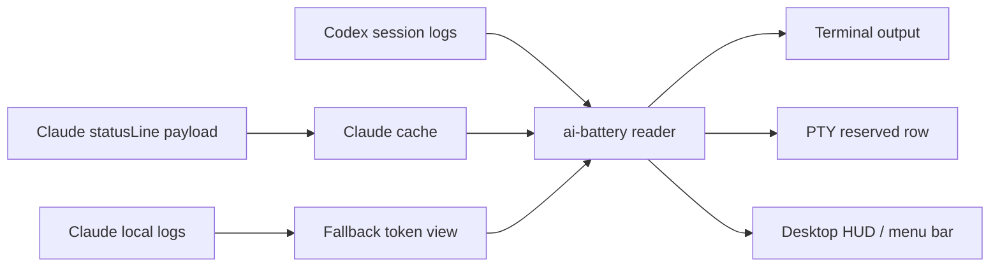

# AI Battery

0.1.24: `ai-battery setup` enables automatic Claude and Codex usage display. The original Codex launcher and existing configuration are preserved. Settings reset and npm package removal remain separate operations.

[한국어](../../../README.md) · [English](../en/) · [日本語](../ja/) · [中文](../zh/) · [Español](../es/)

Codex and Claude Usage Battery Meter

A terminal status display tool that shows the remaining Codex and Claude Code usage like a battery.


[Install](#install) · [Features](#features) · [Quick Start](#quick-start) · [Claude StatusLine](#claude-statusline) · [Desktop HUD](#desktop-hud) · [Caution](#caution)

## Overview

`ai-battery` is a small status display tool for keeping an eye on remaining usage and reset times while using Codex and Claude Code.

For Codex, it reads `rate_limits` events from local session logs. For Claude Code, it caches the rate-limit payload delivered by the `statusLine` hook. When Claude records an actual 429 rate-limit hit, that limit is shown as 0% until the corresponding reset time. The default output stays compact on one line: running tools are shown in white, inactive tools in gray, and only the battery bar changes color based on remaining usage: green, orange, or red.


The Markdown text fallback omits the bar to avoid renderer-specific differences in block character height. In a real terminal, ANSI colors and block bars are rendered together.

```text
Codex 86% │ 5h 18:09 │ 7d 82%  ┃  Claude 4% │ 5h 18:10 │ 7d 71%
```

| Provider | Source | Shows |
| --- | --- | --- |
| Codex | `~/.codex/sessions/**/*.jsonl` | 5h remaining, 5h reset time, 7d remaining |
| Claude Code | Claude `statusLine` payload cache + 429 hit logs | 5h remaining, 5h reset time, 7d remaining |
| Claude fallback | `~/.claude/projects/**/*.jsonl` | Recent turn token usage |

## Features

| Feature | Description |
| --- | --- |
| Shared usage display | Shows Codex and Claude Code usage in the same format. |
| Reset time display | Shows `5h` and `7d` window labels and values. |
| Color thresholds | Highlights only the battery: green above 40%, orange from 21-40%, and red at 20% or below. |
| Codex terminal row | Keeps Codex direct on Windows and docks an external row; WSL/Linux/macOS use a PTY wrapper. |
| Claude statusLine | Reads Claude rate-limit state from Claude Code's built-in statusLine hook and actual 429 hit logs. |
| HUD / menu bar | Provides terminal-docked/floating HUDs on Windows, a floating HUD on WSL, and a menu bar status item on macOS. |
| npm execution | Can be run with `npm install -g` or `npx`. |

## Platform Support

| Mode | Windows native | WSL | Linux | macOS | Note |
| --- | --- | --- | --- | --- | --- |
| `ai-battery` | Supported | Supported | Supported | Supported | Requires Node.js 18 or newer. |
| `ai-battery --watch` | Supported | Supported | Supported | Supported | Refreshes periodically inside the terminal. |
| Claude statusLine | Supported | Supported | Supported | Supported | Saves a `node <script>` command to Claude Code `statusLine`. |
| Codex fullscreen | Supported | Supported | Supported | Supported | Windows: fullscreen PTY composition; WSL/Linux/macOS: POSIX PTY and Python 3. |
| `ai-battery setup codex` | Supported | Supported | Supported | Supported | Enables a managed PATH wrapper while preserving the original Codex launcher and configuration. |
| `ai-battery hud` | Supported | Supported | Unsupported | Supported | Windows/WSL use a PowerShell/WinForms HUD; macOS uses a menu bar status item. |

Runtime detection uses `/proc` on Linux/WSL, `ps` on macOS, and PowerShell process listings on Windows. Text output uses white/gray, while the macOS HUD highlights only running items with colored battery bars and shows inactive items in muted gray.

## Install

```bash
npm install -g ai-battery
```

You can also run it immediately without installing.

```bash
npx ai-battery
```

The previous command names, `claudex-battery`, `claudex-battery-run`, and `claudex-battery-hud`, are still provided as compatibility aliases.

## Quick Start

1. Install the package.

   ```bash
   npm install -g ai-battery
   ```

2. Configure the Claude statusLine and automatic Codex display.

   ```bash
   ai-battery setup
   ```

3. Open a new terminal or apply the shell refresh instructions printed by setup, then use the original commands as usual.

   ```bash
   claude
   codex
   ```

4. Optionally start a separate desktop HUD on Windows/WSL/macOS.

   ```bash
   ai-battery hud
   ```

## CLI

```bash
ai-battery
ai-battery --watch 10
ai-battery --json
ai-battery --version
ai-battery --provider codex
ai-battery --provider claude
ai-battery setup
ai-battery reset settings
ai-battery doctor
ai-battery hud
ai-battery off codex
ai-battery on codex
```

| Option | Description |
| --- | --- |
| `--provider all\|codex\|claude` | Chooses which provider to show. |
| `--watch [seconds]` | Refreshes periodically on the same line. |
| `--json` | Outputs JSON that is convenient for HUDs or other tools. |
| `--bar-width N` | Adjusts the terminal battery bar width. |
| `--show-paths` | Shows log file paths and data observation timestamps. |
| `-v`, `--version` | Prints the installed `ai-battery` version. |

`doctor` checks the installation state and the latest npm version. If the network is unavailable, only the version check is skipped and the rest of the diagnostics are still shown.

<a id="uninstall"></a>
## Reset Settings

`ai-battery reset settings` restores settings changed by AI Battery and cleans its verified caches, private runtimes and generated files. It preserves unrelated Codex/Claude settings, npm packages and package commands. It does not reset all Codex or Claude settings to defaults.

```bash
ai-battery reset settings
```

`ai-battery reset config` is an alias. Select a target to restore only that integration and retain shared caches:

```bash
ai-battery reset settings codex
ai-battery reset settings claude
ai-battery reset settings hud
ai-battery reset settings tmux
```

Edited managed values or blocks are preserved with recovery records, and reset exits with status 1. Unrelated settings, user-added files, unknown files and edits outside managed shell/tmux blocks are preserved. Recovery records are cleared only after successful restoration or safe removal.

To remove the package, restore settings successfully first, then use npm. For a local installation use `npm uninstall ai-battery`; for a global installation:

```bash
ai-battery reset settings && npm uninstall -g ai-battery
hash -r  # Existing Bash terminal; zsh: rehash
```

The CLI never runs npm uninstall automatically. `teardown` and `uninstall` remain compatibility aliases for settings reset. `off` only hides the display. Run separately for Windows, WSL and each Node installation. If npm was removed first, reinstall AI Battery and reset its integrations before removing it again.

A child CLI cannot clear its parent shell's cached command paths. Opening a new terminal also resets them. A running wrapped session retains its terminal row until that session exits.

## Setup

`setup` enables the Claude statusLine hook and automatic Codex usage display. Then launch `claude` and `codex` as usual. Codex uses a separate managed PATH wrapper; its original executable, existing configuration and session history are preserved.

```bash
ai-battery setup
```

Select one tool with `ai-battery setup codex` or `ai-battery setup claude`. In an existing shell, apply the printed `source ...` instructions and run `hash -r`, or open a new terminal. Windows users open a new cmd/PowerShell. Windows and WSL each need setup in their own installation.

Codex's built-in `[tui].status_line` is optional and is not changed by default. Add `--configure-codex-statusline` only to configure that separate model/directory/branch row. Previous values are recorded for restoration.

Opt out of automatic Codex integration with `ai-battery setup codex --no-wrap-codex`. For a separate display use a watcher/HUD; for one wrapped session use `ai-battery-run -- codex` on POSIX or `ai-battery-run-win -- codex` on Windows. Windows composite/HUD runner behavior also applies to the default automatic integration.

In tmux, reserving a bottom row in every pane would duplicate the same global battery as many times as there are panes. Instead, you can show it once per session in the tmux status bar.

```bash
ai-battery setup tmux
```

This adds a managed block to `~/.tmux.conf`, displays the battery in `status-right` with a 10-second refresh interval, and lets `codex` inside tmux use the full pane instead of adding a per-pane battery row. Claude statusLine also collapses the battery row in the same environment and shows only the header row (model, directory, branch), because the battery is already in the tmux bar. To apply it, run `tmux source-file ~/.tmux.conf` and open a new pane. This block overwrites the existing `status-right` setting, so it is opt-in and not included in `setup all`. Remove it with `ai-battery reset settings tmux`; set `AI_BATTERY_TMUX=row` if you want to keep per-pane rows inside tmux. Claude statusLine is part of the Claude Code internal UI, so it is displayed regardless of tmux.

Run diagnostics if the Codex bottom row does not appear.

```bash
ai-battery doctor
```

Use the short on/off commands to choose which providers are shown.

```bash
ai-battery off codex
ai-battery on codex
ai-battery off claude
ai-battery on claude
ai-battery off all
ai-battery on all
```

This setting applies to the CLI, Claude statusLine, Codex wrapper, and HUD together.

## Codex Terminal Row

After `ai-battery setup`, plain `codex` displays the AI Battery row automatically. Refresh the existing shell as instructed by setup or open a new terminal. For one explicitly wrapped session:

```bash
ai-battery-run --provider all -- codex       # WSL/Linux/macOS
ai-battery-run-win --provider all -- codex   # Windows cmd/PowerShell
```

Use `--interval` to reduce the refresh interval.

```bash
ai-battery-run --interval 1 --provider all codex
```

The default Windows `composite` mode and the WSL/Linux/macOS status row poll usage in the background every 2 seconds by default. Terminal input and output continue during slow queries, and each poll can take up to 10 seconds. Failed polls retry after 1 second, with longer delays after consecutive failures. The previous reading is marked `[stale]` until a poll succeeds; failures before any successful reading display `AI Battery unavailable`.

New or changed Codex usage logs invalidate the parsing cache for the next poll, even before its normal expiry. Values reflect the latest reading provided by local Codex logs and Claude statusLine, rather than a live server query. Delayed source updates can still delay the display. Use `ai-battery --show-paths` to inspect the data's observation time and source.

## Claude StatusLine

Claude Code provides rate-limit usage and reset times through the built-in `statusLine` hook. AI Battery combines that with actual 429 rate-limit hit records from Claude JSONL. After installation, Claude renders two lines.


```text
Opus high · ~/Projects · main                               83% context left
Codex 71% │ 5h 00:47 │ 7d 90%  Claude 76% │ 5h 00:47 │ 7d 59%
```

The first line shows the model, reasoning level, workspace root, and git branch, with remaining Claude context pinned to the right edge. The second line shows Codex and Claude usage in the same format.

Setup:

```bash
ai-battery setup claude
```

Remove:

```bash
ai-battery reset settings claude
```

Claude must deliver a statusLine payload at least once before the Claude usage cache is created. Until then, the Claude local log fallback is shown.

## Desktop HUD

Drawing a status line safely over a normal terminal from an external process is not reliable. AI Battery therefore provides a floating overlay on Windows and a top menu bar status item on macOS. On Windows native, it runs directly through PowerShell/WinForms without WSL; from WSL, it launches the same HUD through `powershell.exe`. On macOS, it displays Codex and Claude logos, compact meters, and percentages as a small SVG image with a transparent background. Click it to see detailed status.

```bash
ai-battery hud
```

The HUD runs in the background and immediately returns control to the terminal. The Windows HUD can be moved by dragging, and the saved position is reused on the next launch. The macOS menu bar item appears in the right side of the system menu bar.

```text
Codex  [battery:88] │ 5h 00:47 │ 7d 93%
Claude [battery:76] │ 5h 00:47 │ 7d 59%
```

| Command | Role |
| --- | --- |
| `ai-battery hud` / `ai-battery hud start` | Starts the Windows floating HUD or macOS menu bar item. |
| `ai-battery hud stop` | Stops the running HUD/menu bar item. (`--stop` is the same.) |
| `ai-battery hud status` | Shows whether the HUD/menu bar item is running and whether autostart is registered. |
| `ai-battery hud autostart on` | Registers automatic startup on Windows login or macOS login. |
| `ai-battery hud autostart off` | Removes automatic startup registration. |
| `ai-battery hud autostart status` | Shows only autostart registration status. |
| `ai-battery hud -Foreground` | Runs attached to the terminal for debugging. |
| `ai-battery hud -Once` | Prints once in the console. |
| `ai-battery hud -Interval 2` | Changes the refresh interval. |
| `ai-battery hud -Mode tray` | Runs in Windows tray icon mode. On macOS, the menu bar item is the default. |
| `ai-battery hud light` / `ai-battery hud dark` | Switches the Windows floating HUD to black text for a light taskbar or white text for a dark taskbar. |
| `ai-battery hud black` / `ai-battery hud white` | Sets the text color directly to black or white. |
| `ai-battery hud --backdrop` / `ai-battery hud --no-backdrop` | Enables or disables the dark backing behind Windows floating HUD text. |

The Windows floating HUD defaults to bright text on a transparent background. Use `ai-battery hud light` for a light taskbar or `ai-battery hud dark` for a dark taskbar. To pick the text color directly, use `ai-battery hud black` or `ai-battery hud white`. Add the same mode when saving login autostart, such as `ai-battery hud autostart on light`.

Windows autostart is registered per user under `HKCU\Software\Microsoft\Windows\CurrentVersion\Run`. On Windows native it runs directly without WSL, and when registered from WSL a copy of the HUD script is placed under `%LOCALAPPDATA%\ai-battery`. macOS autostart is registered as `~/Library/LaunchAgents/com.ai-battery.hud.plist`. After updating ai-battery, run `ai-battery hud autostart on` again to refresh the registered path.

## Shell Prompt

You can also add it to your shell prompt.

```bash
export PS1='$(ai-battery --provider codex) '"$PS1"
```

The prompt method refreshes every time a command runs. Use `ai-battery setup` or `ai-battery hud` if you want a persistent display.

## How It Works



Codex looks for `rate_limits` events in recent session logs. Claude Code provides usage and reset times through the statusLine payload, and actual 429 rate-limit hit logs are reflected as 0% until reset. In fallback mode, only recent token usage can be checked.

## Tech Stack

| Layer | Technology | Role |
| --- | --- | --- |
| CLI | Node.js | Log parsing, Claude cache, ANSI/statusLine output |
| PTY row | Python 3 | Reserved terminal row for running Codex |
| HUD launcher | Node.js / Bash compatibility wrapper | Launches the Windows native/WSL PowerShell HUD and macOS menu bar |
| HUD UI | PowerShell WinForms / AppleScriptObjC | Windows floating overlay, tray icon, macOS menu bar item |
| Data | JSONL logs, statusLine JSON | Codex/Claude usage sources |

## Source Environment

The default CLI runs on Windows native, WSL, Linux, and macOS when Node.js 18 or newer is available. Windows runs Codex directly and uses a PowerShell/WinForms docked HUD by default; rowpty and same-console overlays are used only by explicitly selected compatibility layouts. On WSL/Linux/macOS, `ai-battery-run` uses Python 3 and POSIX PTY. macOS uses built-in `osascript` with AppleScriptObjC for its menu bar HUD.

Codex data is read from the `sessions` directory in the `CODEX_HOME` actually used by Codex (default: `~/.codex`). AI Battery never sets or changes `HOME`, `USERPROFILE`, or `CODEX_HOME`. Changing `CODEX_HOME` also changes Codex's own `/resume` store, so do not use it to combine Windows and WSL paths. Comma-separated homes are not supported.

```bash
CODEX_HOME=/path/to/codex-home ai-battery --provider codex
```

When native Windows and WSL are used together, each environment keeps its own sessions and `/resume` history. Only the account-wide Codex 5h/7d usage is shared through AI Battery's `codex-account-usage.json`; session paths, workspaces, and approval/sandbox modes are never shared. Set `AI_BATTERY_SHARED_USAGE_STATE_DIR` only when the shared usage state itself needs an explicit location.

Claude usage display becomes available after installing the Claude Code statusLine hook.

## Caution

- This tool reads local logs and Claude statusLine payloads. It does not replace the service's official billing or limit screen.
- If Codex rate-limit events have not been created yet or are stale, the display may differ from the latest state.
- Claude statusLine provides only usage and reset times, so actual hit state is combined with 429 rate-limit logs left by Claude.
- The HUD is based on PowerShell/WinForms on Windows and a menu bar status item on macOS. On WSL, it uses both `powershell.exe` and `wsl.exe`.
- `ai-battery-run` is a PTY wrapper. Some full-screen TUIs may briefly disturb the status row because of screen-clearing escape sequences.
